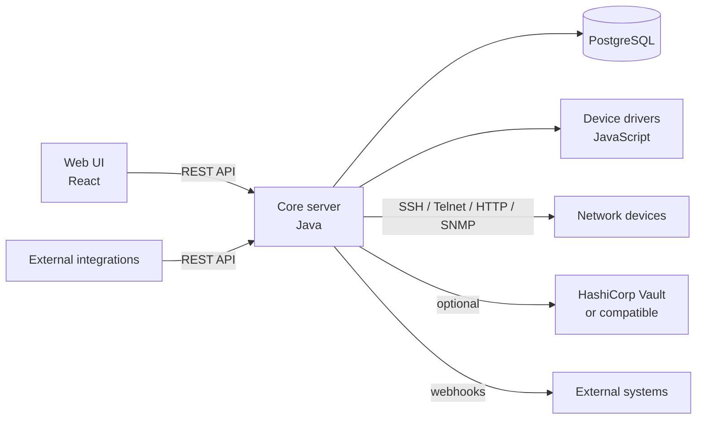

# Architecture

Netshot is a server application with a web front end. This page gives a map of its main components before you dive into installing, administering, or extending it.

## Overview

## Core server

The core server is a Java application. It is organized into a set of packages under `net.netshot.netshot`, each responsible for one concern:

- **`task`** — the task engine. `Task` and its subclasses (under `task.type`) represent scheduled or on-demand jobs — snapshots, scans, script runs, diagnostics — with support for hierarchical (parent/child) tasks. The `task.engine` sub-package runs them: `TaskManager` schedules tasks, `MasterJob` drives execution on the cluster's elected master, and `TaskJob` runs a task on a runner, using `TaskLockManager` (PostgreSQL advisory locks in cluster mode) so that a task never runs twice and only one task works on a given device at a time.
- **`inventory`** — the device inventory model. `inventory.device` holds `Device`, `NetworkInterface`, `Module` and the network/physical address types, with the custom device attributes in `inventory.device.attribute`; `inventory.group` the device groups (`StaticDeviceGroup`, `DynamicDeviceGroup`); `inventory.domain` the `Domain`s; `inventory.config` the collected `Config`s and their attributes (`inventory.config.attribute`); and `inventory.search` the `Finder` query engine behind device search.
- **`driver`** — the device driver model: `DeviceDriver` (loading and running the JavaScript drivers) with its attribute and option definitions.
- **`access`** — network access to the devices (SSH, Telnet, HTTP, SNMP clients, `AccessManager`, per-access connection settings). Its `access.collector` sub-package contains the servers used to pull data off a live session or receive it (SNMP traps, syslog, TFTP, SSH/SCP).
- **`credentials`** — the CLI/HTTP/SNMP/SSH account and community types (`DeviceCredentialSet` and subclasses), local or Vault-backed.
- **`devicescript`** — running scripts against a device (snapshot, diagnostic, user scripts) over SSH/Telnet/HTTP/SNMP, with the helpers exposed to the scripts under `devicescript.helper`. `userscript` contains `DeviceJsScript`, the stored user-defined device script entity.
- **`compliance`** — the rule engine: `Policy`, `Rule` and its subclasses (`SoftwareRule`, `HardwareRule`, plus config rules), `CheckResult`, and `Exemption`.
- **`diagnostic`** — diagnostic definitions (`SimpleDiagnostic`, `JavaScriptDiagnostic`, `PythonDiagnostic`) and their typed results (`DiagnosticTextResult`, `DiagnosticNumericResult`, `DiagnosticBinaryResult`, `DiagnosticLongTextResult`).
- **`aaa`** — authentication and authorization: local users (`User`, `UiUser`), API tokens (`ApiToken`) and the password policy in `aaa.user`, and the RADIUS, TACACS+, and OIDC (`Oidc`) integrations in `aaa.auth`.
- **`cluster`** — high-availability support: `ClusterManager` and `ClusterMember` implement the master/runner election model described in [Clustering and High Availability](clustering-ha.md).
- **`vault`** — the optional HashiCorp Vault (or compatible) integration for externally-stored credentials: `VaultInstance`/`HashicorpVaultKv2Instance` for configured backends, `VaultClient` for the HTTP calls, `VaultManager` and `VaultTokenRefreshDaemon` for lifecycle/token-refresh, and `VaultableSecret`/`VaultKeyPath` for the fields on a device credential that can point at a Vault path instead of a locally-stored value. See [Vault instances](user-guide/administration.md#vault-instances).
- **`hook`** — outbound webhooks: `Hook`, `WebHook`, and the `HookTrigger`s that fire them. See [Webhooks](api/webhooks.md).
- **`api`** — the API layer: `api.rest` (Jersey application, security and logging filters, exception mapper) and `api.rest.v0` (`RestService`, the current REST API), which is the only way the Web UI talks to the core server, and is also available for external integrations. See [REST API](api/rest-api.md).
- **`platform`** — technical building blocks that do not depend on the features above: `platform.database` (Hibernate configuration, naming strategies, the encrypted-column support `StringEncryptorConverter` used for secrets stored in the database, and the Liquibase data migrators in `platform.database.migrator`), `platform.crypto` (password hashing such as `Argon2idHash` and `Sha2BasedHash`, reversible encryption for stored secrets such as `Sha2AesPasswordBasedEncryptor`, password generation), `platform.tls` (HTTPS trust policies and the Bouncy Castle loader) and `platform.rest` (REST serialization views).
- **`boot`** — the composition root: `Wiring` builds the long-lived objects (transaction support, and the services as they are introduced) and `EntityModel` lists the persistent entities given to the database layer.
- **`tools`** — standalone helpers: the demo data creator and the device list extractor.

The layering rules, the conventions and the way the REST layer is being restructured are described in [Backend architecture](extending/backend-architecture.md).

## Persistence

Netshot stores its inventory, configurations, compliance results, and settings in **PostgreSQL**, accessed through the `platform.database` package. Device credential secrets are encrypted at rest by default, or can be delegated to an external Vault instance (see above).

## Device drivers

Support for a given device platform is implemented as a **JavaScript driver** — a single script file under `src/main/resources/drivers`, loaded (and reloadable at runtime) by the core server. Drivers declare how to connect to a device, what to collect (running/startup configuration, hardware/software versions, modules, interfaces...), and expose diagnostics and script hooks. See [Device drivers](user-guide/device-drivers.md) for the concept and [Writing a new driver](extending/writing-a-driver.md) to add support for a new platform.

## Web UI

The Web UI is a React single-page application, served by the core server and talking to it exclusively through the REST API. It provides the device inventory, compliance, diagnostics, reports, tasks, and administration screens described in the [user guide](user-guide/devices.md).

## REST API

Every action available in the Web UI — and more — is exposed over the REST API, which is also the supported way to integrate Netshot with external systems (CMDBs, automation pipelines, monitoring). See [REST API](api/rest-api.md).
