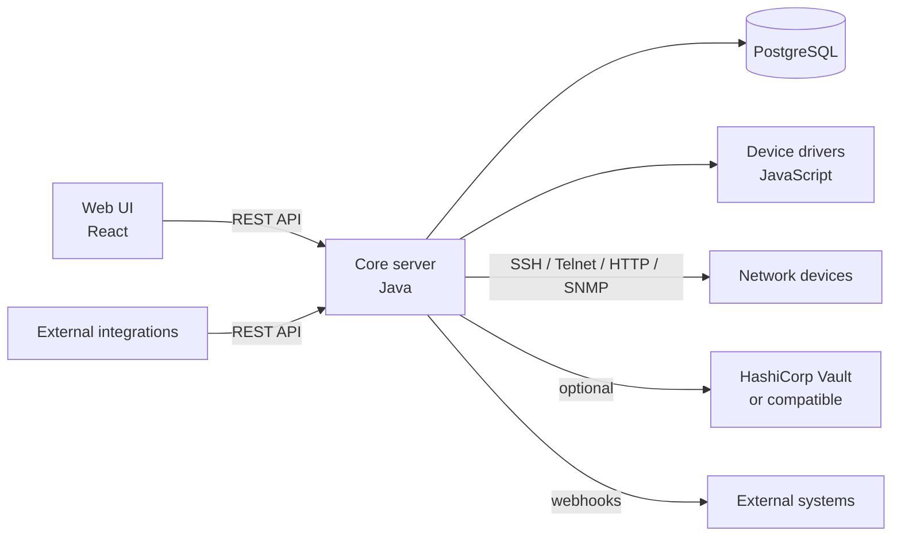

# Architecture

Netshot is a server application with a web front end. This page gives a map of its main components before you dive into installing, administering, or extending it.

## Overview

## Core server

The core server is a Java application. It is organized into a set of packages under `net.netshot.netshot`, each responsible for one concern:

- **`task`** — the task engine. `Task` and its type-specific specifications (`TaskSpec`, under `task.type`) represent scheduled or on-demand jobs — snapshots, scans, script runs, diagnostics — with support for hierarchical (parent/child) tasks. The `task.engine` sub-package runs them: `TaskManager` schedules tasks, `MasterJob` drives execution on the cluster's elected master, and `TaskJob` runs a task on a runner (by calling the `TaskHandler` of the task type, found in `task.handler`; the group tasks use `ChildTaskOrchestrator` to track their child tasks), using `TaskLockManager` (PostgreSQL advisory locks in cluster mode) so that a task never runs twice and only one task works on a given device at a time.
- **`inventory`** — the device inventory model. `inventory.device` holds `Device`, `NetworkInterface`, `Module` and the network/physical address types, with the custom device attributes in `inventory.device.attribute`; `inventory.group` the device groups (`StaticDeviceGroup`, `DynamicDeviceGroup`); `inventory.domain` the `Domain`s; `inventory.config` the collected `Config`s and their attributes (`inventory.config.attribute`); and `inventory.search` the `Finder` query engine behind device search.
- **`driver`** — the device driver model: `DeviceDriver` (the driver descriptor and its JavaScript runtime) with its attribute and option definitions, the `DriverRegistry` (the loaded drivers, looked up by name or description), the `DriverLoader` (reads the drivers from the user folder and the bundled ones) and the `DriverConfigParser`.
- **`access`** — network access to the devices (SSH, Telnet, HTTP, SNMP clients, `AccessManager`, per-access connection settings). Its `access.collector` sub-package contains the servers used to pull data off a live session or receive it (SNMP traps, syslog, SSH/SCP).
- **`credentials`** — the CLI/HTTP/SNMP/SSH account and community types (`DeviceCredentialSet` and its records), local or Vault-backed.
- **`devicescript`** — running scripts against a device (snapshot, diagnostic, user scripts) over SSH/Telnet/HTTP/SNMP, with the helpers exposed to the scripts under `devicescript.helper`. `userscript` contains `DeviceJsScript`, the stored user-defined device script.
- **`compliance`** — the rule engine: `Policy`, `Rule` and its kinds (`SoftwareRule`, `HardwareRule`, plus config rules), `CheckResult`, and `Exemption`. The rule definitions are records; the way a config rule is evaluated lives in `compliance.check` (`ComplianceChecker`, one `RuleEvaluator` per rule type behind the `RuleEvaluators` registry, and the JavaScript/Python runtimes of the script rules).
- **`diagnostic`** — diagnostic definitions (`SimpleDiagnostic`, `JavaScriptDiagnostic`, `PythonDiagnostic`) and their typed results (`DiagnosticTextResult`, `DiagnosticNumericResult`, `DiagnosticBinaryResult`, `DiagnosticLongTextResult`). How a diagnostic is handed to a device script and how its value becomes a result is in `diagnostic.run` (one `DiagnosticAdapter` per diagnostic type behind the `DiagnosticAdapters` registry).
- **`aaa`** — authentication and authorization: local users (`User`, `UiUser`), API tokens (`ApiToken`) and the password policy in `aaa.user`, the user, API token and login use cases (`UserService`, `ApiTokenService`, `LoginService`), and the RADIUS, TACACS+, and OIDC (`Oidc`) integrations in `aaa.auth`.
- **`cluster`** — high-availability support: `ClusterManager` and `ClusterMember` implement the master/runner election model described in [Clustering and High Availability](clustering-ha.md); `ClusterService` gives the REST layer the members and the mastership status.
- **`system`** — general information about the running server (`ServerInfoService`: version and session idle timeout).
- **`vault`** — the optional HashiCorp Vault (or compatible) integration for externally-stored credentials: `VaultInstance`/`HashicorpVaultKv2Instance` for configured backends, `VaultClient` for the HTTP calls, `VaultManager` and `VaultTokenRefreshDaemon` for lifecycle/token-refresh, and `VaultableSecret`/`VaultKeyPath` for the fields on a device credential that can point at a Vault path instead of a locally-stored value. See [Vault instances](user-guide/administration.md#vault-instances).
- **`hook`** — outbound webhooks: `Hook`, `WebHook`, and the `HookTrigger`s that fire them, plus the `HookService` use cases. The hooks are executed by the webhook channel in `api.hook`, which reacts to the `TaskFinished` event of the task engine. See [Webhooks](api/webhooks.md).
- **`api`** — the API layer: `api.hook` (the webhook channel: `HookDispatcher`, `WebHookSender` and the payload DTOs in `api.hook.payload`), `api.rest` (the web server `RestServer`, the Jersey application, security and logging filters, exception mapper) and `api.rest.v0` (the current REST API: one package of resources, DTOs and mappers per feature), which is the only way the Web UI talks to the core server, and is also available for external integrations. See [REST API](api/rest-api.md).
- **`platform`** — technical building blocks that do not depend on the features above: `platform.database` (the connection pools, the transactions, the jOOQ set-up with the classes generated from the schema in `platform.database.schema`, the encrypted-column support `EncryptedStringConverter` used for secrets stored in the database, and the Liquibase data migrators in `platform.database.migrator`), `platform.crypto` (password hashing such as `Argon2idHash` and `Sha2BasedHash`, reversible encryption for stored secrets such as `Sha2AesPasswordBasedEncryptor`, password generation), `platform.tls` (HTTPS trust policies and the Bouncy Castle loader), `platform.rest` (the serialization views of the cluster wire format), `platform.event` (`DomainEvents`, a synchronous in-process publish/subscribe), `platform.config` (the configuration snapshots and the declared settings, reloaded on `HUP`), `platform.lifecycle` (the services and the `ServiceManager` which starts and stops them) and `platform.concurrent` (the named thread factory of the executors).
- **`boot`** — the composition root: `Wiring` builds the long-lived objects (transaction support, repositories and services) and lists the services of the server in start order; `NetshotSettings` is the catalog of the configuration settings, `LoggingSetup` sets the logging up from the configuration. See [Configuration and services](extending/backend-architecture.md#configuration-and-services).
- **`tools`** — standalone helpers: the demo data creator and the device list extractor.

The layering rules, the conventions and the way the REST layer is being restructured are described in [Backend architecture](extending/backend-architecture.md).

## Persistence

Netshot stores its inventory, configurations, compliance results, and settings in **PostgreSQL**, accessed with [jOOQ](https://www.jooq.org) through the `platform.database` package; the schema is created and upgraded by Liquibase at startup. Device credential secrets are encrypted at rest by default, or can be delegated to an external Vault instance (see above).

## Device drivers

Support for a given device platform is implemented as a **JavaScript driver** — a single script file under `src/main/resources/drivers`, loaded (and reloadable at runtime) by the core server. Drivers declare how to connect to a device, what to collect (running/startup configuration, hardware/software versions, modules, interfaces...), and expose diagnostics and script hooks. See [Device drivers](user-guide/device-drivers.md) for the concept and [Writing a new driver](extending/writing-a-driver.md) to add support for a new platform.

## Web UI

The Web UI is a React single-page application, served by the core server and talking to it exclusively through the REST API. It provides the device inventory, compliance, diagnostics, reports, tasks, and administration screens described in the [user guide](user-guide/devices.md).

## REST API

Every action available in the Web UI — and more — is exposed over the REST API, which is also the supported way to integrate Netshot with external systems (CMDBs, automation pipelines, monitoring). See [REST API](api/rest-api.md).
